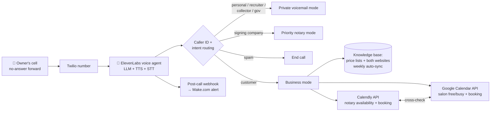

# AI Voice Receptionist: Two Businesses, One Phone Line

A real-time voice agent that answers every missed call for two service businesses, a mobile notary/signing company and a mobile haircut service, sharing one owner and one phone. It quotes prices with live travel estimates, books into two different calendar systems without double-booking the owner, routes priority callers, and acts as a private voicemail for personal and sensitive callers so they never learn the businesses exist.

**Status:** live on the owner's business line since November 2026

## Problem

One person runs two businesses from one cell phone. Before this agent:

- Missed calls went to a generic voicemail, and most callers never left one.
- Spam rolled in from rotating spoofed numbers, 8 calls in 3 hours at its worst.
- Notary signing companies, who award jobs to whoever answers first, were lost to faster notaries.
- Personal callers, recruiters and collectors heard business information the owner wanted kept private.

## What it does

| Caller | What the agent does |
|---|---|
| **New customer (notary)** | Thanks them for calling the notary business, quotes from the price list, estimates mobile travel from the office, checks Calendly availability, books, reminds them to bring ID |
| **New customer (haircuts)** | Thanks them for calling the salon brand, quotes per person plus travel from a private origin it never discloses, checks Google Calendar free/busy, books with an email invite |
| **Signing company / title / escrow** | Priority mode: takes assignment details (date, city, signing type, fee, accept-by deadline), never accepts or negotiates, marks it urgent |
| **Family & friends** | Matched by caller ID against the owner's contact labels: short personal message, no business talk |
| **Recruiters, collectors, government, specific area codes** | Personal voicemail mode: name, number, reason, then hang up. Never confirms the businesses exist |
| **Spam / robocalls** | One line ("please take this number off your list") and ends the call |

## Architecture

## Engineering highlights

- **Cross-business conflict prevention.** Before offering a notary slot, the agent queries the salon calendar's free/busy for the same window, and vice versa, with a 30-minute travel buffer. Two independent booking systems behave like one schedule.
- **Two auth patterns.** Calendly through a bearer-token auth connection; Google Calendar through an OAuth2 JWT service account with domain-wide delegation, so the agent books as the business account without a user login.
- **Caller-ID routing before anything else.** The first instruction block normalizes `{{system__caller_id}}` and checks it against contact-label lists and area-code rules, so private callers get the private flow before the agent says a word about any business.
- **Location-aware quoting with a hidden origin.** Each business measures travel from a different starting point; the salon's origin is private and the agent is forbidden to disclose it, even when asked directly.
- **California two-party consent built in.** The greeting discloses recording and asks for consent. Decline → polite exit with a text-only alternative.
- **Tuned from real call transcripts.** Every iteration came from reading transcripts: accepting "mm-hmm" as yes, no "are you still there?", answering questions before asking its own, one closing disclaimer per call instead of every turn, repeating names back, hanging up cleanly.
- **Self-improving loop.** A weekly scheduled agent reads the past 7 days of calls, applies low-risk prompt fixes, and sends the owner a summary. Rules that affect money, privacy or consent are locked and need human approval.
- **Monthly price sync.** A scheduled job reads the websites' price pages into a folder; a second job updates the agent's price list from it and reports failures.

## Guardrails

- Never claims to be human; answers honestly if sincerely asked.
- Never books a time it hasn't confirmed through a booking tool.
- Never shares the owner's personal address, origin ZIP, schedule, or personal number, except the business text line to legitimate customers.
- Never accepts, declines or negotiates signing assignments.
- Never confirms account numbers, SSNs, birth dates or payment details to anyone.

## Stack

ElevenLabs Conversational AI (voice agent, TTS, STT, RAG knowledge base, webhook tools) · Twilio voice number · Calendly API · Google Calendar API (service account + domain-wide delegation) · Make.com post-call webhook · Claude scheduled tasks (weekly review, monthly price sync)

## Files

- [`agent-prompt.md`](agent-prompt.md): the system prompt, sanitized (real numbers, contact lists, IDs and addresses replaced with placeholders)
- [`tools.example.json`](tools.example.json): the five webhook tool definitions with credentials and IDs removed
