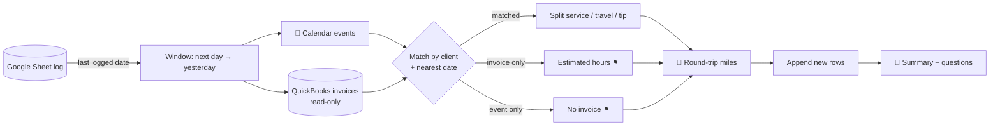

# Appointment & Mileage Logger Agent

A weekly scheduled agent for a mobile service business. It reconciles the calendar against QuickBooks invoices, computes round-trip mileage for each visit, and appends clean rows to a payroll-and-tax log in Google Sheets, so the owner never rebuilds the week from memory.

**Status:** runs every Monday morning since October 2026

## Problem

A mobile cosmetology business bills per visit plus travel. Payroll needs hours per appointment, and the mileage deduction needs a trip log. Those facts live in three places (calendar, invoices, maps) and the owner was reconstructing them by hand every pay period.

## What the agent does

| Step | Action |
|---|---|
| 1. Read the log | Reads the Google Sheet; notes every logged appointment (date + client) and the latest date |
| 2. Calendar | Lists events from the day after the last logged date through yesterday; filters out personal events, travel blocks, admin tasks and cancellations; hours = end − start |
| 3. QuickBooks | Queries invoices and sales receipts in the same window (± a few days, since invoices drift) and matches each to an appointment by client + nearest date |
| 4. Split lines | Service $, travel $, discounts, tips from invoice lines; multi-day invoices are split evenly across visit days |
| 5. Gaps | Invoice with no calendar event → row with *estimated* hours flagged "Yes". Event with no invoice → row with blank $ and "no invoice found" |
| 6. Mileage | Round-trip driving miles from home base to each client; same-day multi-stop routes are logged once on the first row |
| 7. Append | Appends only new rows, oldest first, with a per-row total formula; never touches the totals block or existing rows |
| 8. Report | One short message: rows added, new running totals (hours, billed, miles), and anything that needs an answer |

## Design decisions

- **Append-only.** The agent may add rows but never edit or delete existing ones, and never writes to QuickBooks or the calendar.
- **Idempotent windowing.** The start date comes from the sheet itself, so a missed week is caught up automatically and nothing is double-logged.
- **Flag, don't guess.** Estimated hours and missing invoices are written with explicit flags so a human resolves them.
- **Known-distance cache.** Frequent client routes are stored in the prompt as known round-trip miles; only new addresses are computed.

## Stack

Claude scheduled task (cron) · Google Calendar · QuickBooks Online (read-only connector) · Google Sheets API (via Composio) · driving-distance lookup

## Files

- [`agent-prompt.md`](agent-prompt.md): the scheduled-agent instruction set (sanitized)

> All client names, addresses, IDs and amounts in this folder are placeholders.
