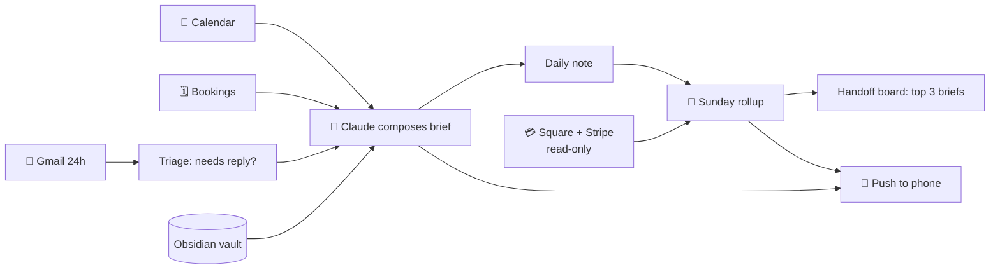

# AI Executive Assistant: Morning Brief & Weekly Rollup

Two scheduled Claude agents that act as a chief of staff for an owner running several small businesses. Every morning one reads the calendar, booking system and inbox and sends a one-screen brief. Every Sunday the other scores the week, pulls revenue, and sets next week's top three priorities.

**Status:** in daily use since October 2026

## Problem

Running three service businesses means three calendars, two booking tools, two payment processors and one overflowing inbox. The owner was starting every day by checking six apps and still missing replies that needed a decision.

## Agent 1: Morning brief (daily, 6:47 AM)

| Step | Action |
|---|---|
| 1. Calendar | Today and tomorrow from Google Calendar (in-home service appointments) |
| 2. Bookings | Today's appointments from the scheduling tool (Calendly) |
| 3. Inbox triage | Last 24 h of Gmail; keeps only threads that need a reply or a decision (max 5, one line each), drops newsletters and promos |
| 4. Notes vault | If the owner's Obsidian vault is reachable, reads overdue / due-in-7-days tasks and the decisions log |
| 5. Brief | Writes a phone-screen brief: **Top 3 today** (at least one moves money) · Calendar · Inbox, needs you · Deadlines (7 days, plus launch dates inside 30 days) · One money move |
| 6. File + send | Saves the brief to the vault's daily note, logs the run, and pushes it to the owner's phone |

## Agent 2: Weekly rollup (Sunday, 5:47 PM)

| Step | Action |
|---|---|
| 1. Review the week | Reads the last 7 daily notes, the task list, the agent handoff board and the decisions log |
| 2. Revenue | Pulls revenue booked this week, **read-only**, from Square and Stripe, split by business |
| 3. Scorecard | Top-3 hit rate, revenue, content published, average energy; repeated wins, repeated misses, root cause |
| 4. Prioritize | Picks next week's top 3 with a fixed order: compliance deadlines → cash this week → launch dates → audience growth |
| 5. Handoff | Writes each priority as a brief on the handoff board, then sends a 6-line summary labelled NEW / UPDATE / REVISIT |

## Design decisions

- **Draft-only guardrail.** Both agents are forbidden to send email, book, pay, sign or post. They read, summarize and draft; the owner acts.
- **Fits one phone screen.** The brief has a fixed five-section shape and hard caps (5 inbox items, 3 priorities) so it is read, not skimmed.
- **Deterministic prioritization.** A written priority order (compliance → cash → launches → growth) makes the Sunday plan predictable and easy to audit.
- **Degrades gracefully.** If the laptop with the notes vault is offline, the brief still runs from cloud sources and says what it skipped.

## Stack

Claude scheduled tasks (cron) · Google Calendar · Gmail · Calendly · Square & Stripe (read-only) · Obsidian vault (local files) · push notifications

## Files

- [`prompts.md`](prompts.md): both scheduled-agent instruction sets (sanitized)

> Business names, dates and figures in this folder are placeholders.
