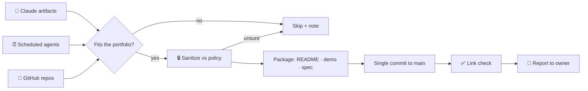

# Self-Updating Portfolio Curator Agent

A monthly scheduled agent that keeps this portfolio current. It scans the month's new work (published Claude artifacts, newly scheduled agents, and public GitHub repos), decides what fits, sanitizes it, and commits it here with updated README cards and landing-page tiles. The page you are reading was added by it.

**Status:** runs on the 1st of every month since October 2026

## Problem

Real client work is built fast and rarely makes it into a portfolio, because each piece needs sanitizing, a write-up, a demo page and README edits. Doing that by hand once a quarter means the portfolio is always out of date.

## What the agent does

| Step | Action |
|---|---|
| 1. Discover | Lists artifacts updated in the last ~35 days, scheduled tasks created in that window, and recently pushed public repos |
| 2. Qualify | Keeps AI agents, scheduled workflows, web apps, websites and product specs; skips forks, personal pages, legal documents and anything financial |
| 3. Sanitize | Applies a written confidentiality policy: no employer, client or tenant names, account numbers, IDs, personal addresses or financial figures; replaces them with placeholders |
| 4. Package | Writes `agents/<slug>/README.md` + sanitized prompts, `apps/<slug>/index.html`, `product-specs/<slug>/index.html` following the repo's structure |
| 5. Publish | Updates the root README (badges, project cards, ▶ Live tables, mermaid diagrams) and the landing page, then commits everything to `main` in one atomic commit |
| 6. Verify | Checks every new GitHub link through the API and every Pages URL after deploy |
| 7. Report | Pushes a short summary to the owner, including anything left out because it was borderline |

## Design decisions

- **Policy as a deny-list, default to omit.** When the agent is unsure whether something is confidential it leaves it out and says so in the report.
- **One atomic commit.** All new folders plus README and landing-page edits land together, so the site is never half-updated.
- **No destructive actions.** It cannot delete files, change repo visibility or touch other repositories.
- **"Nothing new" is a valid outcome.** If no work qualifies it makes no commit and reports that.

## Stack

Claude scheduled task (cron) · Claude artifact & scheduled-task APIs · GitHub API (via Composio: tree reads, multi-file commits) · GitHub Pages · headless Chromium smoke tests

## Files

- [`agent-prompt.md`](agent-prompt.md): the scheduled-agent instruction set (sanitized)
