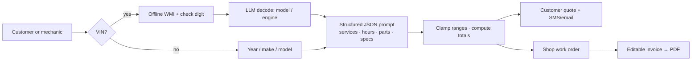

# AI Mobile Mechanic Quote Tool

A two-sided web app for a budget mobile mechanic. Customers describe the problem and get a plain-English diagnosis, a safe-to-drive call and a tight price range in about a minute. The mechanic gets a full work order (book labor hours, parts with specs, torque values, step-by-step procedure) and an editable invoice that exports to PDF.

**[▶ Live demo](https://oxayavongsa.github.io/ai-automation-portfolio/apps/mobile-mechanic-quote/)** · built October 2026 for a real local mobile-mechanic business (name and contact details replaced with placeholders)

> In production the page runs inside Claude, which supplies the language model. This static copy has no model attached, so it opens on a worked example (2015 Accord, front brakes + fluid flush) for both views.

## Features

| View | What it does |
|---|---|
| **Customer** | Year / make / model / optional VIN, symptom chips, free-text problem → diagnosis, "is it safe to drive?", what we'll do, a lump-sum quote, a "we buy parts vs. I'll buy my own" toggle, comparison with local shop labor, and one-tap text/email of the pre-filled quote request |
| **Shop** | VIN decode (offline WMI table + check-digit validation, then model/engine lookup), VIN-from-photo OCR, multi-job picker, AI repair guide: tools, specs, parts with OEM numbers and store links, 6–14 step procedure, warnings |
| **Invoice** | Editable itemized quote/invoice (parts, labor, fees, tax on parts, deposits) → branded PDF via jsPDF |
| **Chat** | Slide-in assistant that answers follow-ups with the current quote as context |

## How the pricing stays honest

- One structured JSON call per job returns services, book labor hours, local-shop labor ranges and retail part prices.
- Every range is clamped to a maximum spread (e.g. $200) by shrinking around the midpoint, so service rows, parts, labor and the total always add up exactly.
- Labor = book hours × the shop's own rate; the savings badge compares that to the model's estimate of local independent-shop labor.
- The prompt asks for the most cost-effective reliable repair and forbids unnecessary upsells; unknown specs must say "verify in service info" rather than guess.

## Stack

Vanilla JS + CSS (single file, no framework) · Claude structured-JSON sampling with 24 h caching · jsPDF + autoTable · responsive, light/dark, accessible form controls
